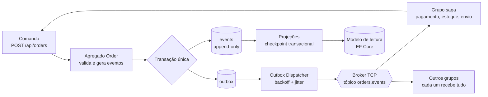
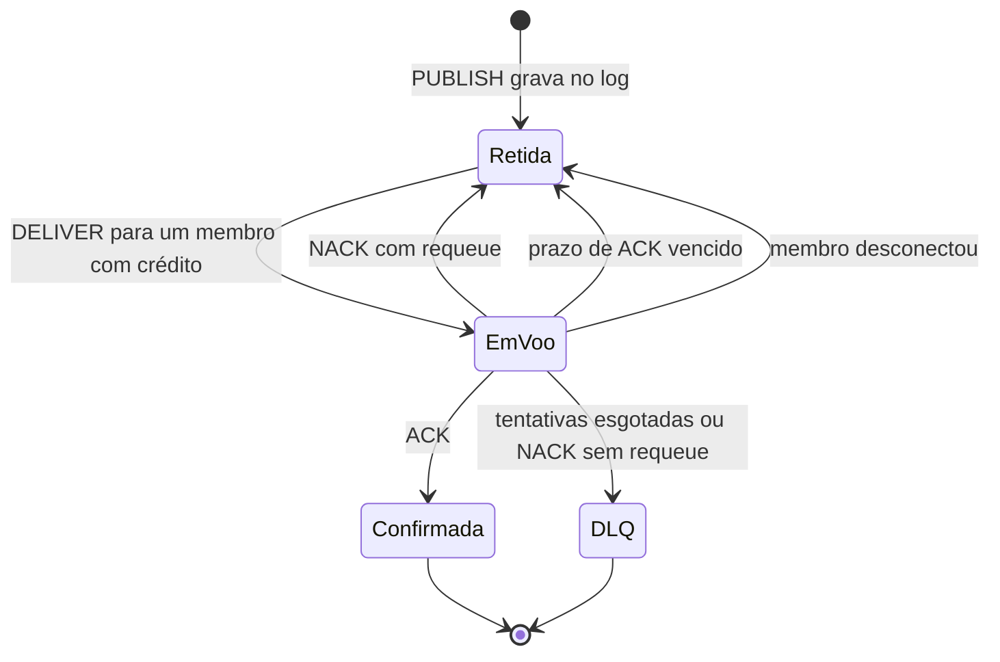
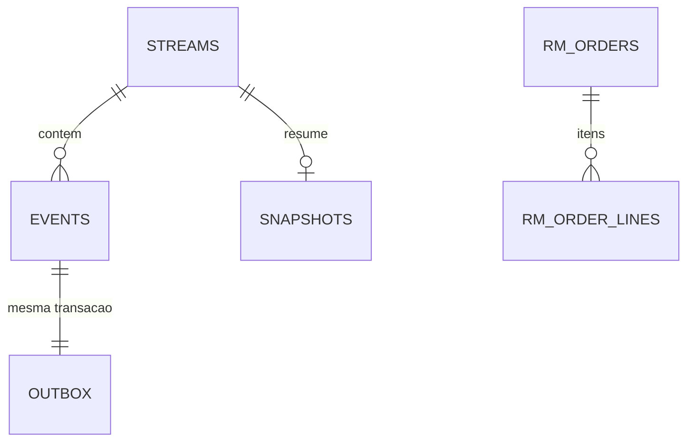

<p align="center">
  
</p>

<h1 align="center">Brado<br><sub><sup><sup><sub>Copyright (©) 2026 Clara Portes</sub></sup></sup></sub></h1>

<p align="center">
  Motor de mensageria distribuído no estilo mini-Kafka/RabbitMQ, combinado com um banco de eventos.<br>
  Publishers e subscribers conversam por um protocolo TCP próprio, cada mudança vira um evento imutável e nenhuma mensagem se perde entre o banco e o broker, mesmo com quedas de rede.
</p>

<p align="center">
  Versão 1.1.0. Feito com C#, .NET 10, ASP.NET Core, Dapper, EF Core, PostgreSQL ou SQLite, xUnit, Testcontainers, BenchmarkDotNet, Docker e GitHub Actions.
</p>

<p align="center">
  
</p>

## Documentação

| Documento | Conteúdo |
|---|---|
| [`Brado-Manual-Tecnico.pdf`](docs/pdf/Brado-Manual-Tecnico.pdf) | Instalação, configuração, conceitos do broker, protocolo TCP, cliente .NET, API, cada área do painel, Event Sourcing, CQRS, saga, outbox, testes, operação e automação diária |
| [`Brado-Arquitetura-Banco-de-Dados.pdf`](docs/pdf/Brado-Arquitetura-Banco-de-Dados.pdf) | Diagrama de relacionamentos, todas as tabelas com campos, tipos e chaves, regras de concorrência e imutabilidade e como o banco deve evoluir |

Os dois manuais são gerados a partir de HTML em `.design/docs-src/` com `python .design/docs-src/render.py`.

## O que o Brado faz

- Roda um broker TCP próprio em `System.Net.Sockets` que atende vários publishers e subscribers ao mesmo tempo. O protocolo é binário, com cabeçalho fixo. Cada conexão tem um `Channel<T>` limitado (backpressure), e a codificação usa `Span<T>`, `Memory<T>` e `ArrayPool`.
- Guarda cada tópico como um log append-only com offsets, como o Kafka. Os grupos de consumo dividem as mensagens com prefetch, ACK e NACK, como no RabbitMQ.
- Reentrega a mensagem que não recebeu ACK no prazo. Depois de 5 tentativas ela vai para `<tópico>.dlq`.
- Grava mensagens e offsets dos grupos em lote no banco, então o broker volta de onde parou depois de reiniciar.
- Aplica Event Sourcing ao pedido: o estado nunca é gravado direto. Cada mudança (`OrderCreated`, `PaymentProcessed` e outras) entra na tabela `events`, protegida por trigger contra UPDATE e DELETE, com controle otimista de versão e snapshots automáticos.
- Separa escrita e leitura (CQRS). Comandos passam pelos agregados e gravam com Dapper; consultas leem visões desnormalizadas no Entity Framework Core, que podem ficar em outro banco e ser reconstruídas do zero a partir do log.
- Usa Outbox: o evento e a mensagem a publicar são gravados na mesma transação, e um `BackgroundService` entrega ao broker com backoff exponencial e jitter.
- Coordena pagamento, reserva de estoque e envio com uma saga, sem transação distribuída. Se o estoque falha, a saga estorna o pagamento e cancela o pedido.
- Trata repetição em todas as bordas: ids únicos de evento e mensagem, inbox por consumidor e checkpoint das projeções na mesma transação das visões.
- Mostra tudo num painel em tempo real com Server-Sent Events.

## Ver rodando

Pré-requisito: .NET SDK 10.

```bash
dotnet run --project src/Brado.Server
```

Sobe com SQLite, sem configuração. Os bancos ficam em `data/`, o schema é criado na primeira execução e o painel abre em http://localhost:5080. Em `Development` o tráfego de demonstração já vem ligado; em qualquer ambiente, o botão **Simular tráfego** gera pedidos e mensagens.

Para ver só a interface, com dados sintéticos e sem servidor, abra http://localhost:5080/?demo.

| Serviço | Endereço | Função |
|---|---|---|
| Painel e API | http://localhost:5080 | Painel, API REST e Server-Sent Events |
| Broker | tcp://localhost:7420 | Protocolo binário para publishers e subscribers |

## Instalar

### Requisitos

- .NET SDK 10 (o `global.json` fixa 10.0.100 e aceita versões mais novas).
- Docker, para o PostgreSQL e os testes de integração (Docker Desktop no Windows e no macOS).
- Portas 5080 e 7420 livres.

### Passo a passo com SQLite

```bash
git clone https://github.com/Violet-pixel/Distributed-Event-Messaging-Engine.git
cd Distributed-Event-Messaging-Engine
dotnet restore Brado.slnx
dotnet run --project src/Brado.Server
```

### Com PostgreSQL

```bash
docker compose up -d postgres
dotnet run --project src/Brado.Server --environment Postgres
```

O ambiente `Postgres` carrega `appsettings.Postgres.json`, que usa o banco `brado` para escrita e `brado_read` para leitura (criado automaticamente).

### Tudo em contêineres

```bash
docker compose up --build
```

Sobe o PostgreSQL 17 e o servidor com o tráfego de demonstração ligado.

## Usar

### O painel

O painel é HTML, CSS e JavaScript puros, servido pelo próprio servidor. Ele mostra:

- a fita de eventos recentes, logo abaixo do topo: a cauda do log global, com o número de sequência, o tipo, o stream e a hora de cada evento;
- indicadores de entrada e saída em msg/s, conexões ativas, eventos gravados, outbox pendente e lag total, cada um com mini-gráfico do último minuto;
- a taxa de transferência dos últimos 2 minutos, publicadas e entregues, com os totais de reentregas e mensagens na DLQ;
- filas e grupos de consumo com offset, retenção, lag, mensagens em voo e membros; tópicos `.dlq` aparecem com a etiqueta "fila de erros";
- conexões TCP com o papel de cada cliente (publisher, subscriber ou os dois) e a fila de saída;
- event store, sagas e outbox;
- o replay de eventos: escolha um stream e reproduza o estado do pedido versão a versão, com reproduzir, avançar e voltar.

O botão **Reconstruir projeções** apaga o modelo de leitura e o refaz a partir do log. O tema segue o sistema ou o botão do topo, e a escolha fica guardada no navegador.

| Tema claro | Tema escuro |
|---|---|
|  |  |
|  |  |

O visual parte da ideia de uma fita de teletipo: o log de eventos é uma fita perfurada e os furos de cada quadro representam em binário o número de sequência do evento. As cores têm função fixa:

| Cor | Claro | Escuro | Uso |
|---|---|---|---|
| Névoa / fundo | `#EDF0F3` | `#0F1824` | Fundo da página |
| Tinta | `#15202B` | `#D7DEE6` | Texto e furos da fita |
| Cobalto | `#2A49D6` | `#6F8BFF` | Ações, links, série de publicadas, passo atual do replay |
| Âmbar | `#EFA23B` | `#EFA23B` | Em voo ou pendente: lag, outbox pendente, sagas em andamento |
| Verde-sinal | `#2C8A57` | `#4CB57C` | Confirmado: entregues, sagas concluídas |
| Vermelho-sinal | `#C23B33` | `#E5605A` | Falha, DLQ, cancelado |

As fontes são [Archivo](https://github.com/Omnibus-Type/Archivo), com títulos em largura expandida, e [JetBrains Mono](https://www.jetbrains.com/lp/mono/), só para código (tópicos, ids, tipos de evento, offsets e JSON). As duas ficam em `src/Brado.Server/wwwroot/fonts`. A logo é sempre em preto e branco.

### Gerar carga pelo protocolo TCP

```bash
dotnet run --project samples/Brado.Demo -- run
dotnet run --project samples/Brado.Demo -- publish --topic demo.metricas --rate 2000 --publishers 4
dotnet run --project samples/Brado.Demo -- subscribe --topic demo.metricas --group painel --consumers 3
dotnet run --project samples/Brado.Demo -- bench --messages 200000 --size 256
```

Cada `subscribe` com o mesmo `--group` é mais um membro dividindo as mensagens; grupos diferentes recebem tudo.

### Cliente .NET

`BradoConnection` cuida da conexão, da correlação de respostas, do keep-alive e do ACK automático:

```csharp
using Brado.Client;
using Brado.Protocol;

await using var connection = await BradoConnection.ConnectAsync("localhost", 7420, "checkout-api");

var offset = await connection.PublishJsonAsync("pedidos.criados", new { pedido = 42, total = 359.30m });

await using var assinatura = await connection.SubscribeAsync(
    topic: "pedidos.criados",
    group: "faturamento",
    handler: async (message, cancellationToken) =>
    {
        var pedido = message.AsJson<PedidoCriado>();
        await faturamento.EmitirAsync(pedido, cancellationToken);
    },
    prefetch: 64,
    startOffset: StartPosition.Earliest);
```

Se o handler termina normalmente, o cliente envia ACK; se lança exceção, envia NACK com requeue. A entrega é *at-least-once*, então o handler precisa ser idempotente. `message.Redelivered` avisa quando é uma reentrega.

### Criar um pedido pela API

```bash
curl -X POST http://localhost:5080/api/orders \
  -H "Content-Type: application/json" \
  -d '{"customerRef":"CLI-1001","submit":true,"items":[{"sku":"LIV-ARQ-001","quantity":2,"unitPrice":129.90}]}'
```

## Por dentro

### Caminho de uma mensagem



1. O repositório grava os eventos, a nova versão do stream e as mensagens do outbox numa única transação. Se o banco aceitou, a mensagem vai sair; se recusou, nada é publicado.
2. O comando informa a versão que leu. Se outro escritor gravou antes, a transação é abortada e o comando é refeito até 3 vezes. A restrição única `(stream_id, stream_version)` é a última barreira.
3. O dispatcher reserva lotes do outbox por tempo limitado (`FOR UPDATE SKIP LOCKED` no PostgreSQL), publica em ordem e só marca como entregue depois que o broker confirma.
4. Cada grupo entrega a um membro por vez, respeitando o prefetch. O offset confirmado do grupo só avança sobre ACKs contíguos.
5. O `messageId` de cada envelope é o próprio id do evento, e a saga registra o que já tratou na tabela `processed_messages`.

### Ciclo da mensagem no broker



### Garantias de entrega

| Camada | Mecanismo | Comportamento padrão |
|---|---|---|
| Publicação | `PUBLISH_ACK` com offset | O publisher só considera enviado depois que o broker grava no log |
| Prefetch | Créditos por membro | Até 64 mensagens sem ACK por membro |
| Prazo de ACK | Manutenção a cada segundo | Mensagem sem ACK em 30 s volta para a fila |
| Novas tentativas | Contador por offset | Até 5 entregas, marcadas com a flag `Redelivered` |
| Fila de erros | Tópico `<tópico>.dlq` | Recebe a mensagem quando as tentativas acabam |
| Outbox | Backoff exponencial com jitter | Começa em 1 s, dobra a cada falha e para em 5 min, com 20% de variação |
| Persistência | Journal em lote e `consumer_offsets` | Mensagens gravadas em lotes de até 512; offsets dos grupos a cada 5 s |

### Banco de dados

São dois bancos lógicos que nunca compartilham tabelas: o de escrita (Dapper e SQL por dialeto) e o de leitura (EF Core). Os dois funcionam em PostgreSQL e SQLite, e o schema é criado na subida de forma idempotente.



| Tabela | O que guarda |
|---|---|
| `streams` | Um registro por agregado, com tipo e versão atual |
| `events` | O log imutável: posição global, versão no stream, tipo, payload e metadados em JSON |
| `snapshots` | Último estado serializado de cada stream, para carregar mais rápido |
| `outbox` | Mensagens a publicar, com tentativas, lease e data de entrega |
| `saga_instances` | Estado de cada saga de atendimento |
| `processed_messages` | Mensagens já tratadas por cada consumidor (inbox) |
| `broker_messages`, `consumer_offsets` | Journal do broker e offset confirmado de cada grupo |
| `rm_orders`, `rm_order_lines`, `rm_daily_sales`, `rm_checkpoints` | Modelo de leitura e checkpoint das projeções |

Todos os campos, tipos, chaves, índices e regras estão em [`Brado-Arquitetura-Banco-de-Dados.pdf`](docs/pdf/Brado-Arquitetura-Banco-de-Dados.pdf).

### Estrutura

```
src/
  Brado.Protocol/        quadros binários, codec com Span e leitura e escrita em stream
  Brado.Domain/          agregado Order, eventos de domínio e envelope
  Brado.Broker/          tópicos, grupos de consumo, servidor TCP, handlers e métricas
  Brado.Client/          cliente TCP para publishers e subscribers
  Brado.EventStore/      event store, outbox, sagas, inbox e journal com Dapper
  Brado.Cqrs/            comandos, consultas, modelo de leitura e projeções com EF Core
  Brado.Workers/         outbox dispatcher, projeções e saga como BackgroundService
  Brado.Server/          host ASP.NET Core, API, Server-Sent Events e painel
samples/
  Brado.Demo/            gerador de carga pelo protocolo TCP
tests/
  Brado.UnitTests/       testes de unidade
  Brado.IntegrationTests/ broker TCP real e PostgreSQL com Testcontainers
benchmarks/
  Brado.Benchmarks/      BenchmarkDotNet
docs/                    logos, capturas, manual e arquitetura do banco
```

## Referência

### Configuração

As opções ficam em `src/Brado.Server/appsettings.json` e podem ser sobrescritas por variáveis de ambiente (`EventStore__Provider=Postgres`).

| Seção | Principais opções | Padrão |
|---|---|---|
| `Broker` | `Port`, `MaxConnections`, `MaxPayloadBytes`, `OutboundQueueCapacity` | 7420, 2048, 4 MiB, 8192 |
| `Broker` | `RetainedMessagesPerTopic`, `DefaultPrefetch`, `AckTimeout`, `MaxDeliveryAttempts`, `PersistMessages` | 100 000, 64, 30 s, 5, ligado |
| `EventStore` | `Provider` (`Sqlite` ou `Postgres`), `ConnectionString`, `SnapshotEvery` | `Sqlite`, `data/brado-events.db`, 50 |
| `ReadModel` | `Provider`, `ConnectionString` | `Sqlite`, `data/brado-read.db` |
| `Messaging` | `Mode` (`InProcess` ou `Tcp`), `BrokerHost`, `BrokerPort` | `InProcess`, `localhost`, 7420 |
| `Outbox` | `BatchSize`, `PollingInterval`, `Lease`, `BaseRetryDelay`, `MaxRetryDelay`, `DispatchedRetention` | 200, 500 ms, 30 s, 1 s, 5 min, 7 d |
| `Projections` | `BatchSize`, `PollingInterval` | 500, 1 s |
| `Saga` | `Enabled`, `Topic`, `PaymentFailureRate`, `StockFailureRate`, `SimulatedLatencyMs` | ligada, `orders.events`, 8%, 10%, 120 ms |
| `Simulation` | `Ambient`, `AmbientOrdersPerMinute`, `AmbientMessagesPerSecond` | desligado (ligado em `Development`), 12, 40 |

Para rodar vários servidores com um broker central, use `Messaging__Mode=Tcp` e aponte `Messaging__BrokerHost` para ele. O outbox com `SKIP LOCKED` divide a entrega sem duplicar reservas.

### API

| Método | Rota | Função |
|---|---|---|
| POST | `/api/orders` | Cria um pedido (`submit: true` dispara a saga) |
| POST | `/api/orders/{id}/items`, `/submit`, `/cancel` | Adiciona item, envia ou cancela |
| GET | `/api/orders?status=&page=&pageSize=` | Lista paginada do modelo de leitura |
| GET | `/api/orders/{id}` | Detalhes com os itens |
| GET | `/api/sales/daily?days=`, `/api/read-model` | Vendas por dia e totais por status |
| POST | `/api/projections/rebuild` | Apaga o modelo de leitura e reconstrói por replay |
| GET | `/api/streams?search=`, `/api/streams/{id}/events` | Streams recentes e histórico de um stream |
| GET | `/api/streams/{id}/replay?toVersion=` | Eventos com o estado reconstruído após cada versão |
| GET | `/api/events?after=&take=`, `/api/events/stats` | Log global e contagem por tipo |
| GET | `/api/broker`, `/api/broker/topics/{tópico}/messages` | Fotografia do broker e mensagens de um tópico |
| POST | `/api/broker/topics/{tópico}/publish` | Publica o corpo da requisição |
| GET | `/api/outbox`, `/api/sagas` | Estado do outbox e das sagas |
| GET | `/api/overview` | A fotografia que o painel recebe, numa única resposta |
| GET | `/api/stream` | Server-Sent Events, uma fotografia por segundo |
| POST | `/api/simulate?orders=&messages=` | Gera tráfego de demonstração |
| GET | `/health` | Sonda de vida |

Erros de negócio voltam como `422`, pedido inexistente como `404`, conflito de versão como `409` e entrada inválida como `400`.

### Protocolo TCP

Cabeçalho fixo de 28 bytes, big-endian, validado antes de alocar memória:

```
| magic u16 | versão u8 | tipo u8 | flags u8 | reservado u8 | correlação i64 | offset i64 | tamTópico u16 | tamPayload i32 | tópico | payload |
```

| Código | Quadro | Direção | Função |
|---|---|---|---|
| `0x01`, `0x02` | `HELLO`, `HELLO_ACK` | cliente para broker, broker para cliente | Identifica o cliente |
| `0x10`, `0x11` | `PUBLISH`, `PUBLISH_ACK` | cliente para broker, broker para cliente | Publica e devolve o offset |
| `0x20`, `0x21` | `SUBSCRIBE`, `SUBSCRIBE_ACK` | cliente para broker, broker para cliente | Entra num grupo com posição inicial e prefetch |
| `0x22` | `UNSUBSCRIBE` | cliente para broker | Sai do grupo |
| `0x30` | `DELIVER` | broker para cliente | Entrega com offset e flag de reentrega |
| `0x31`, `0x32` | `ACK`, `NACK` | cliente para broker | Confirma ou rejeita, com ou sem requeue |
| `0x40`, `0x41` | `PING`, `PONG` | os dois lados | Keep-alive |
| `0x7F` | `ERROR` | broker para cliente | Erro de protocolo ou de validação |

### Testes

```bash
dotnet test tests/Brado.UnitTests
dotnet test tests/Brado.IntegrationTests
dotnet run -c Release --project benchmarks/Brado.Benchmarks -- --filter "*"
```

Os testes de unidade cobrem o codec do protocolo, as regras do agregado, os grupos de consumo (competição entre membros, prefetch, ACK contíguo, NACK, fila de erros, troca de membro e prazo de ACK), o event store e o outbox no SQLite, a saga com sucesso, compensação e falha de pagamento, e a reconstrução das projeções.

Os testes de integração sobem o broker de verdade e um PostgreSQL pelo Testcontainers. Eles conferem que vários clientes TCP dividem a carga, que as mensagens de um consumidor que cai vão para outro, que só um de 8 escritores concorrentes grava a mesma versão, que o trigger barra alterações em `events`, que 4 workers nunca reservam a mesma mensagem do outbox e que nenhuma mensagem se perde com o broker fora do ar.

A integração contínua ([`.github/workflows/ci.yml`](.github/workflows/ci.yml)) compila tudo e roda as duas suítes a cada envio.

### Segurança e privacidade

- O repositório não traz senhas reais, chaves nem endereços pessoais. As credenciais do `docker-compose.yml` e do `appsettings.Postgres.json` são de desenvolvimento local; troque-as antes de expor o banco.
- O broker TCP não tem autenticação. Mantenha a porta 7420 em rede interna ou atrás de um proxy com TLS.
- O tamanho do payload e do tópico é validado no cabeçalho, antes de qualquer alocação. Nomes de tópico e grupo aceitam só letras, números, ponto, hífen e sublinhado.
- O painel monta o conteúdo com `textContent` ou texto escapado, então payloads de mensagens nunca são interpretados como HTML.
- Os commits automáticos usam o e-mail `noreply` do GitHub, montado em tempo de execução.
- Não há telemetria, e o painel não carrega nenhum recurso externo: as fontes são servidas pelo próprio Brado.

## Licença

[MIT](LICENSE). Use, copie, altere e distribua à vontade. As fontes Archivo e JetBrains Mono são distribuídas sob a SIL Open Font License (arquivos `OFL-*.txt` em `src/Brado.Server/wwwroot/fonts`).

## **Muito Obrigado pela sua atenção!**
