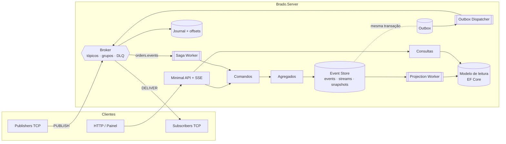

<p align="center">
  
</p>

<h1 align="center">Brado</h1>

<p align="center">Copyright (©) 2026 Clara Portes</p>

<p align="center">
  Motor de mensageria distribuído em <b>C# / .NET 10</b> no estilo mini-Kafka/RabbitMQ, combinado com um banco de eventos:
  broker TCP próprio, <b>Event Sourcing</b>, <b>CQRS</b>, <b>Outbox Pattern</b>, <b>Sagas</b> e um painel em tempo real.
</p>

<p align="center">
  
  
  
  
  
</p>

<p align="center">
  
</p>

---

## Sumário

- [Visão geral](#visão-geral)
- [Recursos](#recursos)
- [Arquitetura](#arquitetura)
- [Começando](#começando)
- [Protocolo binário](#protocolo-binário)
- [Cliente .NET](#cliente-net)
- [API HTTP](#api-http)
- [Configuração](#configuração)
- [Testes e benchmarks](#testes-e-benchmarks)
- [Estrutura do repositório](#estrutura-do-repositório)
- [Documentação](#documentação)
- [Automação de commits](#automação-de-commits)
- [Licença](#licença)

## Visão geral

O Brado junta duas ideias que normalmente vivem em produtos separados:

| Lado | O que faz |
|---|---|
| **Broker** | Servidor `System.Net.Sockets` com protocolo binário próprio. Tópicos são logs append-only com offsets (como no Kafka) e grupos de consumo competem pelas mensagens com prefetch, ACK/NACK, reentrega e DLQ (como no RabbitMQ). |
| **Banco de eventos** | Cada mudança de uma entidade vira um evento imutável (`OrderCreated`, `PaymentProcessed`…) gravado em PostgreSQL ou SQLite. O estado atual é sempre derivado do histórico. |

A ponte entre os dois é o **Outbox**: o evento e a mensagem a publicar são gravados na mesma transação, e um `BackgroundService` entrega ao broker com retentativas. Nada se perde se a rede cair entre o banco e o broker.

## Recursos

- **Broker TCP de alta performance** — `Channel<T>` limitado por conexão (backpressure), `Span<T>`/`Memory<T>` e `ArrayPool` na codificação, `BufferedStream` para agrupar escritas, `TCP_NODELAY`.
- **Semântica de fila sobre log** — offsets monotônicos, grupos de consumo independentes, round-robin entre membros, prefetch, confirmação contígua de offset, reentrega por timeout, dead-letter após N tentativas.
- **Persistência do broker** — journal em lote (group commit) e offsets dos grupos salvos no banco; o broker volta de onde parou após reiniciar.
- **Event Sourcing** — streams com controle otimista de versão, tabela `events` imutável por trigger, snapshots automáticos, replay de qualquer stream versão a versão.
- **CQRS de verdade** — escrita via comandos e agregados (Dapper/SQL puro), leitura via Entity Framework Core em um modelo desnormalizado que pode ficar em outro banco e ser reconstruído do zero.
- **Outbox Pattern** — claim com lease e `FOR UPDATE SKIP LOCKED` no PostgreSQL, backoff exponencial com jitter, entrega at-least-once.
- **Saga orquestrada** — pagamento → reserva de estoque → envio, com compensação (estorno + cancelamento) quando o estoque falha; idempotência por inbox.
- **Painel em tempo real** — Server-Sent Events, gráfico de throughput com rolagem contínua, filas, lag, conexões, sagas, outbox, feed de eventos e replay animado. Tema claro e escuro.
- **Testes** — xUnit v3, Testcontainers com PostgreSQL real e BenchmarkDotNet.

### Padrões de projeto

| Padrão | Onde |
|---|---|
| Observer | `Topic` notifica `ConsumerGroup` (`ITopicObserver`) a cada append |
| Strategy | `IFrameHandler` por tipo de quadro, `SqlDialect` por banco, `IRetryPolicy` |
| Factory | `ITopicFactory`, `SqlDialectFactory`, escolha de transporte em `AddBradoWorkers` |
| CQRS | `ICommandDispatcher` / `IQueryDispatcher` com handlers resolvidos por DI |
| Outbox | `SqlEventStore.AppendAsync` + `OutboxDispatcherService` |
| Saga | `OrderFulfillmentSaga` + `SagaWorker` + `saga_instances` |

## Arquitetura



Fluxo de um pedido:

1. `POST /api/orders` cria o agregado `Order`, que gera `OrderCreated`, `OrderItemAdded` e `OrderSubmitted`.
2. Eventos e mensagens do outbox são gravados juntos; o `ProjectionWorker` atualiza `rm_orders` em milissegundos.
3. O `OutboxDispatcherService` publica os envelopes em `orders.events`.
4. A saga consome, cobra o pagamento, reserva estoque e envia — ou compensa com estorno e cancelamento.

## Começando

### Requisitos

- [.NET SDK 10](https://dotnet.microsoft.com/download)
- Docker (opcional, para PostgreSQL e para os testes de integração)

### Executar com SQLite (zero configuração)

```bash
git clone https://github.com/Violet-pixel/Distributed-Event-Messaging-Engine.git
cd Distributed-Event-Messaging-Engine
dotnet run --project src/Brado.Server
```

- Painel: <http://localhost:5080>
- Broker TCP: `localhost:7420`

Em `Development` o tráfego ambiente já vem ligado. Em qualquer ambiente, o botão **Simular tráfego** gera pedidos e mensagens.

### Executar com PostgreSQL

```bash
docker compose up -d postgres
dotnet run --project src/Brado.Server --environment Postgres
```

Ou tudo em contêineres:

```bash
docker compose up --build
```

### Gerar carga pelo protocolo TCP

```bash
dotnet run --project samples/Brado.Demo -- run
dotnet run --project samples/Brado.Demo -- publish --topic demo.metricas --rate 2000 --publishers 4
dotnet run --project samples/Brado.Demo -- subscribe --topic demo.metricas --group painel --consumers 3
dotnet run --project samples/Brado.Demo -- bench --messages 200000 --size 256
```

## Protocolo binário

Cabeçalho fixo de 28 bytes, big-endian:

```text
| magic u16 | versão u8 | tipo u8 | flags u8 | reservado u8 | correlação i64 | offset i64 | tamTópico u16 | tamPayload i32 | tópico | payload |
```

| Tipo | Código | Direção | Uso |
|---|---|---|---|
| `HELLO` / `HELLO_ACK` | `0x01` / `0x02` | C → S / S → C | identifica o cliente |
| `PUBLISH` / `PUBLISH_ACK` | `0x10` / `0x11` | C → S / S → C | publica e devolve o offset |
| `SUBSCRIBE` / `SUBSCRIBE_ACK` | `0x20` / `0x21` | C → S / S → C | entra em um grupo (grupo, início, prefetch) |
| `UNSUBSCRIBE` | `0x22` | C → S | sai do grupo |
| `DELIVER` | `0x30` | S → C | entrega com offset e flag de reentrega |
| `ACK` / `NACK` | `0x31` / `0x32` | C → S | confirma ou rejeita (com ou sem requeue) |
| `PING` / `PONG` | `0x40` / `0x41` | ambos | keep-alive |
| `ERROR` | `0x7F` | S → C | erro de protocolo ou de negócio |

## Cliente .NET

```csharp
await using var connection = await BradoConnection.ConnectAsync("localhost", 7420, "checkout-api");

var offset = await connection.PublishJsonAsync("pedidos.criados", new { pedido = 42, total = 359.30m });

await using var subscription = await connection.SubscribeAsync(
    topic: "pedidos.criados",
    group: "faturamento",
    handler: async (message, ct) =>
    {
        var pedido = message.AsJson<PedidoCriado>();
        await faturamento.EmitirAsync(pedido, ct);
    },
    prefetch: 64,
    startOffset: StartPosition.Earliest);
```

Se o handler lançar exceção, o cliente envia `NACK` com requeue; após `MaxDeliveryAttempts` a mensagem vai para `pedidos.criados.dlq`.

## API HTTP

| Método | Rota | Lado | Descrição |
|---|---|---|---|
| `POST` | `/api/orders` | escrita | cria pedido (`submit: true` dispara a saga) |
| `POST` | `/api/orders/{id}/items` | escrita | adiciona item |
| `POST` | `/api/orders/{id}/submit` | escrita | envia o pedido |
| `POST` | `/api/orders/{id}/cancel` | escrita | cancela |
| `GET` | `/api/orders?status=&page=&pageSize=` | leitura | lista paginada |
| `GET` | `/api/orders/{id}` | leitura | detalhe com itens |
| `GET` | `/api/sales/daily?days=` | leitura | vendas por dia |
| `POST` | `/api/projections/rebuild` | leitura | apaga e reconstrói o modelo de leitura |
| `GET` | `/api/streams` · `/api/streams/{id}/events` · `/api/streams/{id}/replay` | eventos | streams, histórico e replay com estado |
| `GET` | `/api/events?after=&take=` · `/api/events/stats` | eventos | log global e estatísticas |
| `GET` | `/api/broker` · `/api/broker/topics/{t}/messages` | broker | fotografia e espiar mensagens |
| `POST` | `/api/broker/topics/{t}/publish` | broker | publica o corpo da requisição |
| `GET` | `/api/outbox` · `/api/sagas` | workers | estado do outbox e das sagas |
| `GET` | `/api/stream` | painel | Server-Sent Events, 1 fotografia por segundo |
| `POST` | `/api/simulate?orders=&messages=` | demo | gera tráfego |

```bash
curl -X POST http://localhost:5080/api/orders \
  -H "Content-Type: application/json" \
  -d '{"customerRef":"CLI-1001","submit":true,"items":[{"sku":"LIV-ARQ-001","quantity":2,"unitPrice":129.90}]}'
```

## Configuração

Tudo em `src/Brado.Server/appsettings.json` (ou variáveis de ambiente, ex.: `EventStore__Provider=Postgres`).

| Seção | Chave | Padrão | Descrição |
|---|---|---|---|
| `Broker` | `Port` | `7420` | porta TCP |
| | `RetainedMessagesPerTopic` | `100000` | janela em memória/journal por tópico |
| | `DefaultPrefetch` | `64` | entregas sem ACK por membro |
| | `AckTimeout` | `00:00:30` | prazo até reentregar |
| | `MaxDeliveryAttempts` | `5` | tentativas antes da DLQ |
| | `PersistMessages` | `true` | journal durável |
| `EventStore` | `Provider` | `Sqlite` | `Sqlite` ou `Postgres` |
| | `SnapshotEvery` | `50` | snapshot a cada N eventos |
| `ReadModel` | `Provider` | `Sqlite` | banco do lado de leitura |
| `Messaging` | `Mode` | `InProcess` | `InProcess` ou `Tcp` (broker remoto) |
| `Outbox` | `BatchSize` / `PollingInterval` | `200` / `500 ms` | ritmo do dispatcher |
| | `MaxRetryDelay` | `00:05:00` | teto do backoff |
| `Saga` | `PaymentFailureRate` / `StockFailureRate` | `0.08` / `0.10` | falhas simuladas |
| `Simulation` | `Ambient` | `false` | tráfego contínuo de demonstração |

## Testes e benchmarks

```bash
dotnet test tests/Brado.UnitTests
dotnet test tests/Brado.IntegrationTests
dotnet run -c Release --project benchmarks/Brado.Benchmarks -- --filter "*"
```

| Suíte | Cobre |
|---|---|
| Unitários | codec do protocolo, agregado `Order`, grupos de consumo (competição, prefetch, ACK/NACK, DLQ, timeout), event store SQLite, outbox, repositório com snapshot, saga (sucesso, compensação, falha de pagamento), projeções e rebuild |
| Integração | broker TCP real com vários clientes, reentrega e troca de membro; PostgreSQL via Testcontainers: concorrência otimista, trigger de imutabilidade, `SKIP LOCKED`, outbox sem perda, journal |
| Benchmarks | codificação de quadros, publicação e consumo no broker, `Channel<T>`, append no event store |

## Estrutura do repositório

```text
src/
  Brado.Protocol      quadros binários, codec, leitura/escrita em stream
  Brado.Domain        agregado Order, eventos, envelope
  Brado.Broker        tópicos, grupos de consumo, servidor TCP, métricas
  Brado.Client        cliente TCP para publishers e subscribers
  Brado.EventStore    event store, outbox, sagas, inbox e journal (Dapper)
  Brado.Cqrs          comandos, consultas, modelo de leitura e projeções (EF Core)
  Brado.Workers       outbox dispatcher, projection worker, saga
  Brado.Server        host ASP.NET Core, API, SSE e painel (wwwroot)
samples/Brado.Demo    gerador de carga via TCP
tests/                unitários e integração
benchmarks/           BenchmarkDotNet
docs/                 PDFs, logos e capturas
```

## Documentação

- [Manual técnico de uso (PDF)](docs/pdf/Brado-Manual-Tecnico.pdf)
- [Arquitetura do banco de dados (PDF)](docs/pdf/Brado-Arquitetura-Banco-de-Dados.pdf)

<p align="center">
  
</p>

## Automação de commits

O workflow [`daily-activity.yml`](.github/workflows/daily-activity.yml) roda **5 vezes por dia** (09:17, 11:43, 14:08, 16:52 e 20:26 no horário de Brasília) e registra um checkpoint em `.github/activity/AAAA-MM.md`, gerando um commit por execução. O autor do commit é o dono do repositório, com o e-mail `noreply` do GitHub montado em tempo de execução — nenhum dado pessoal fica no código. Commits feitos pelo `GITHUB_TOKEN` não disparam o CI, então os dois workflows não interferem um no outro.

## Licença

Distribuído sob a licença MIT. Veja [LICENSE](LICENSE).

<p align="center"><sub>Brado · Copyright (©) 2026 Clara Portes</sub></p>
