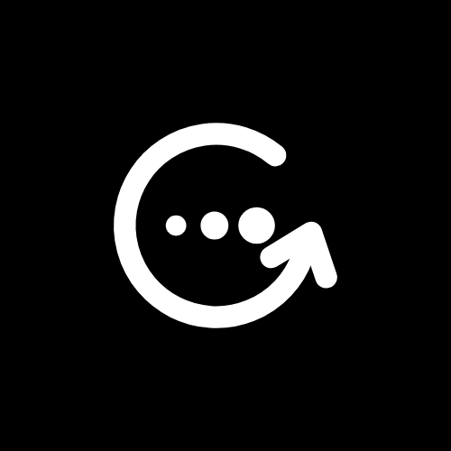
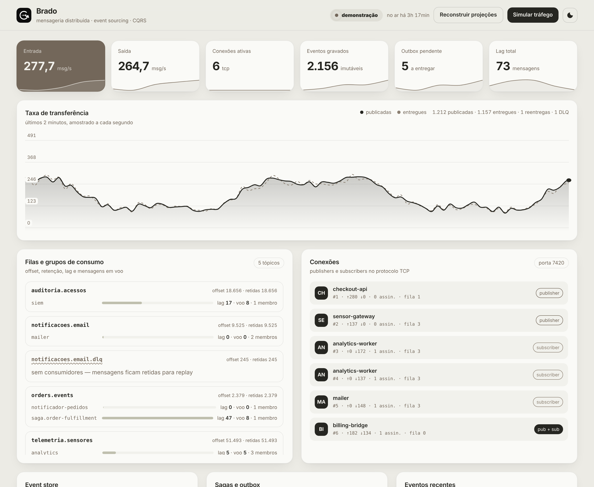
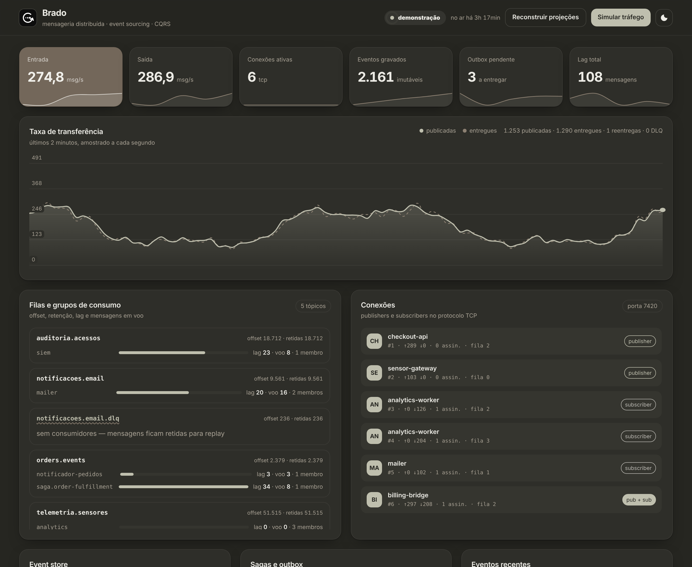
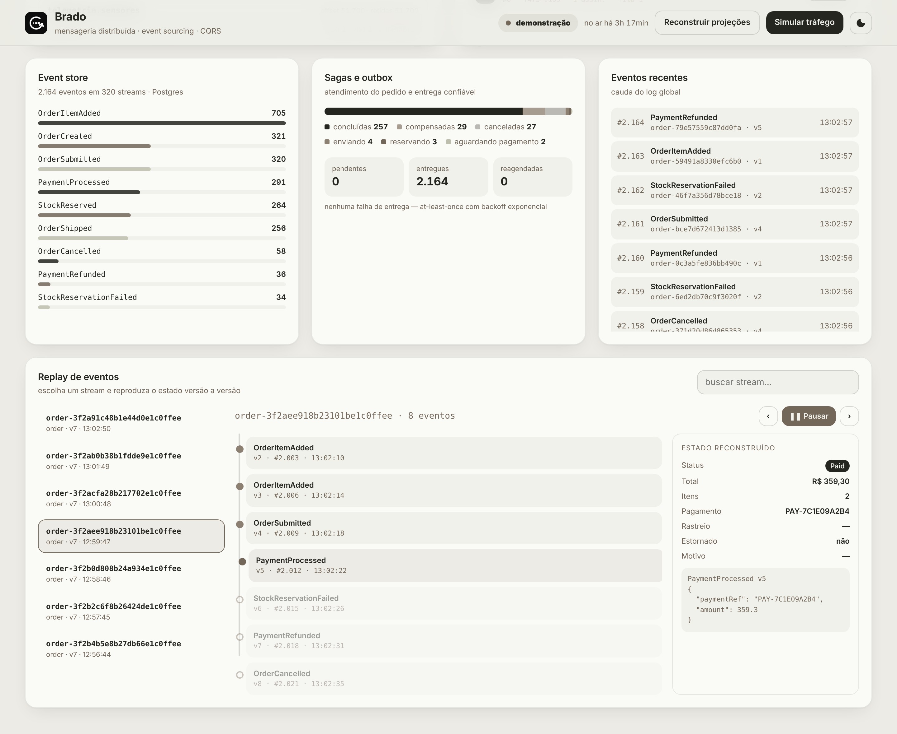
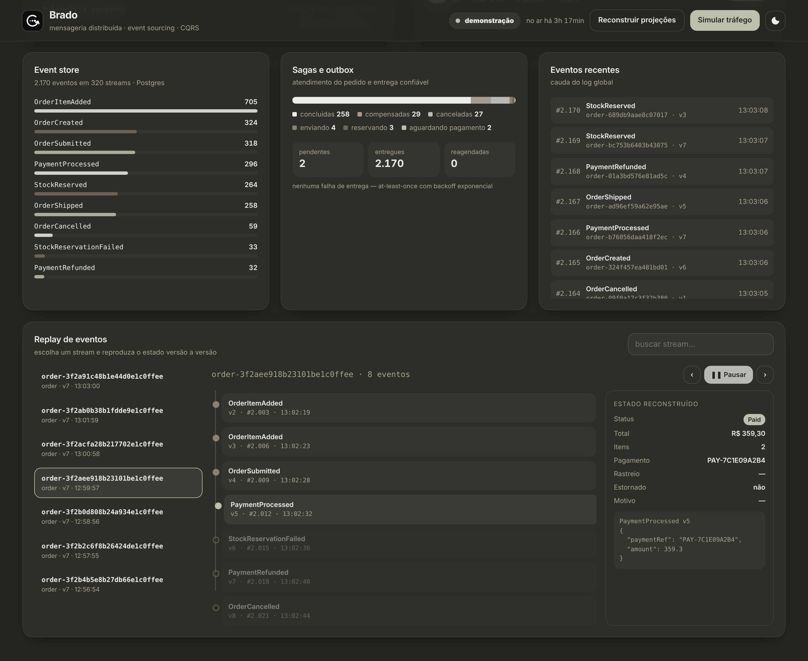
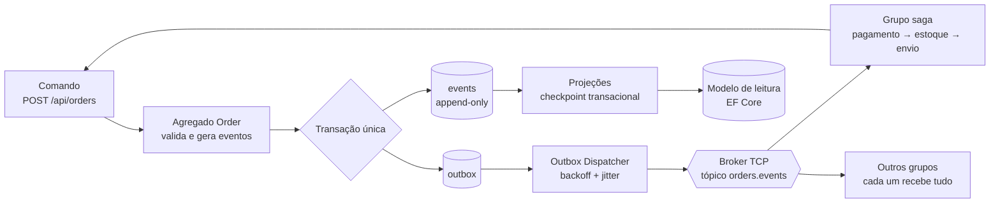
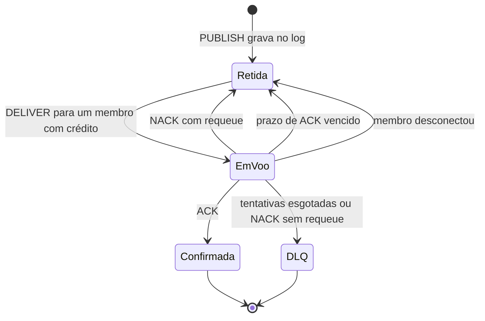
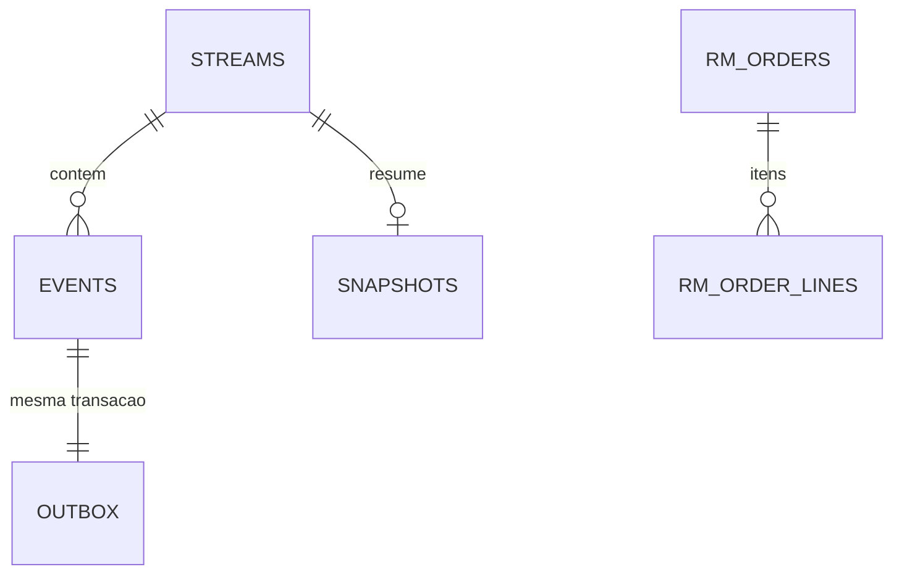

<p align="center">
  
</p>

<h1 align="center">Brado<br><sub><sup><sup><sub>Copyright (©) 2026 Clara Portes</sub></sup></sup></sub></h1>

<p align="center">
  Motor de mensageria distribuído no estilo mini-Kafka/RabbitMQ, combinado com um banco de eventos, em que publishers e subscribers conversam por um protocolo TCP próprio.<br>
  Cada mudança vira um evento imutável, escrita e leitura ficam separadas e nenhuma mensagem se perde entre o banco e o broker, mesmo com quedas de rede.
</p>

<p align="center">
  C# · .NET 10 · System.Net.Sockets · Channels · Span e Memory · ASP.NET Core · Server-Sent Events · Dapper · EF Core · PostgreSQL ou SQLite · xUnit · Testcontainers · BenchmarkDotNet · Docker · GitHub Actions
</p>

---

> **Manual completo:** [`Brado-Manual-Tecnico.pdf`](docs/pdf/Brado-Manual-Tecnico.pdf) explica a instalação, a configuração, os conceitos do broker, o protocolo TCP, o cliente .NET, a API, cada área do painel, Event Sourcing, CQRS, a saga, o outbox, os testes, a operação e a automação diária, passo a passo.

> **Banco de dados:** [`Brado-Arquitetura-Banco-de-Dados.pdf`](docs/pdf/Brado-Arquitetura-Banco-de-Dados.pdf) traz o diagrama de relacionamentos que o banco deve seguir, todas as tabelas com campos, tipos e chaves, as regras de concorrência e imutabilidade e como o banco deve evoluir.

<p align="center">
  
</p>

## O que o Brado faz

- **Broker TCP próprio:** servidor em `System.Net.Sockets` que atende vários publishers e subscribers ao mesmo tempo, com protocolo binário de cabeçalho fixo, `Channel<T>` limitado por conexão (backpressure) e codificação com `Span<T>`, `Memory<T>` e `ArrayPool`.
- **Log com semântica de fila:** cada tópico é um log append-only com offsets, como no Kafka, e os grupos de consumo dividem as mensagens com prefetch, ACK e NACK, como no RabbitMQ.
- **Reentrega e fila de erros:** mensagem sem ACK no prazo volta para a fila; depois de 5 tentativas vai para `<tópico>.dlq`.
- **Persistência do broker:** mensagens e offsets dos grupos são gravados em lote no banco, então o broker volta de onde parou depois de reiniciar.
- **Event Sourcing:** o estado do pedido nunca é gravado direto. Cada mudança (`OrderCreated`, `PaymentProcessed`…) entra na tabela `events`, que é protegida por trigger contra UPDATE e DELETE, com controle otimista de versão e snapshots automáticos.
- **CQRS de verdade:** comandos passam pelos agregados e gravam com Dapper; consultas leem visões desnormalizadas no Entity Framework Core, que podem ficar em outro banco e ser reconstruídas do zero a partir do log.
- **Outbox Pattern:** o evento e a mensagem a publicar são gravados na mesma transação, e um `BackgroundService` entrega ao broker com backoff exponencial e jitter.
- **Saga de atendimento:** pagamento, reserva de estoque e envio coordenados sem transação distribuída, com estorno e cancelamento quando o estoque falha.
- **Idempotência em toda borda:** ids únicos de evento e mensagem, inbox por consumidor e checkpoint das projeções na mesma transação das visões.
- **Painel em tempo real** com Server-Sent Events, gráfico de throughput com rolagem contínua, filas, lag, conexões ativas, sagas, outbox e replay de eventos histórico, com tema claro e escuro.

## Interface

Painel de monitoramento leve, em HTML, CSS e JavaScript puros, servido pelo próprio servidor:

- **Indicadores** numa faixa única: entrada e saída em msg/s, conexões ativas, eventos gravados, outbox pendente e lag total, cada um com mini-gráfico do último minuto.
- **Taxa de transferência** dos últimos 2 minutos, publicadas e entregues, com a escala se ajustando suavemente.
- **Filas e grupos de consumo** com offset, retenção, lag, mensagens em voo e membros de cada grupo; as filas de erro aparecem destacadas.
- **Conexões** TCP com o papel de cada cliente (publisher, subscriber ou os dois) e a fila de saída.
- **Replay de eventos:** escolha um stream e reproduza o estado do pedido versão a versão, com play, avançar e voltar.
- Fundo em areia clara, superfícies quase brancas e bordas finas. O grafite `#262621` aparece no texto, nos botões principais e na série de entrada do gráfico, e o taupe `#73675A` no destaque.
- A marca é sempre em preto e branco.
- Tema escuro com os mesmos tons, seguindo o sistema ou escolhido no botão do topo, e a escolha fica guardada no navegador.
- Fonte [Inter](https://rsms.me/inter/), com JetBrains Mono para offsets, tópicos e JSON.

| Cor | Uso |
|---|---|
| `#262621` | Texto, botões principais, série de entrada e fundo do tema escuro |
| `#73675A` | Destaque, cartão de entrada e textos de apoio |
| `#8C8072` | Lag, série de saída e estados secundários |
| `#BFBFAE` | Grupos tranquilos, barras e destaque no tema escuro |
| `#BBB9B3` | Sagas canceladas e detalhes do tema escuro |

| Tela | |
|---|---|
|  |  |
|  |  |

## Como o Brado entrega mensagens



1. **Gravação atômica:** o repositório grava os eventos, a nova versão do stream e as mensagens do outbox numa única transação. Se o banco aceitou, a mensagem vai sair; se recusou, nada é publicado.
2. **Controle de versão:** o comando informa a versão que leu. Se outro escritor gravou antes, a transação é abortada e o comando é refeito até 3 vezes; a restrição única `(stream_id, stream_version)` é a última barreira.
3. **Entrega com lease:** o dispatcher reserva lotes do outbox por tempo limitado (`FOR UPDATE SKIP LOCKED` no PostgreSQL), publica em ordem e só marca como entregue depois que o broker confirma o recebimento.
4. **Consumo com confirmação:** cada grupo entrega a um membro por vez, respeitando o prefetch. O offset confirmado do grupo só avança sobre ACKs contíguos.
5. **Idempotência no consumidor:** o `messageId` de cada envelope é o próprio id do evento, e a saga registra o que já tratou na tabela `processed_messages`.

### Ciclo da mensagem



## Garantias de entrega

| Camada | Mecanismo | Comportamento padrão |
|---|---|---|
| Publicação | `PUBLISH_ACK` com offset | O publisher só considera enviado depois que o broker grava no log |
| Prefetch | Créditos por membro | Até 64 mensagens sem ACK por membro |
| Prazo de ACK | Manutenção a cada segundo | Mensagem sem ACK em 30 s volta para a fila |
| Novas tentativas | Contador por offset | Até 5 entregas, marcadas com a flag `Redelivered` |
| Fila de erros | Tópico `<tópico>.dlq` | Recebe a mensagem quando as tentativas acabam |
| Outbox | Backoff exponencial com jitter | Começa em 1 s, dobra a cada falha e para em 5 min, com 20% de variação |
| Persistência | Journal em lote + `consumer_offsets` | Mensagens gravadas em lotes de até 512; offsets dos grupos a cada 5 s |

Tudo é configurável nas seções `Broker` e `Outbox` do `appsettings.json`.

## Como rodar

Pré-requisito: **.NET SDK 10**.

```bash
dotnet run --project src/Brado.Server
```

Sobe com SQLite, sem nenhuma configuração. Os bancos ficam em `data/`, o schema é criado na primeira execução e o painel abre em **http://localhost:5080**. Em `Development` o tráfego de demonstração já vem ligado; em qualquer ambiente, o botão **Simular tráfego** gera pedidos e mensagens.

| Serviço | Endereço | Função |
|---|---|---|
| Painel e API | http://localhost:5080 | Painel, API REST e Server-Sent Events |
| Broker | tcp://localhost:7420 | Protocolo binário para publishers e subscribers |

### Com PostgreSQL

Pré-requisito: **Docker** (Docker Desktop no Windows e no macOS).

```bash
docker compose up -d postgres
dotnet run --project src/Brado.Server --environment Postgres
```

Ou tudo em contêineres, com tráfego de demonstração ligado:

```bash
docker compose up --build
```

### Gerando carga pelo protocolo TCP

```bash
dotnet run --project samples/Brado.Demo -- run
dotnet run --project samples/Brado.Demo -- publish --topic demo.metricas --rate 2000 --publishers 4
dotnet run --project samples/Brado.Demo -- subscribe --topic demo.metricas --group painel --consumers 3
dotnet run --project samples/Brado.Demo -- bench --messages 200000 --size 256
```

Cada `subscribe` com o mesmo `--group` é mais um membro dividindo as mensagens; grupos diferentes recebem tudo.

## Protocolo TCP

Cabeçalho fixo de 28 bytes, big-endian, validado antes de alocar qualquer memória:

```
| magic u16 | versão u8 | tipo u8 | flags u8 | reservado u8 | correlação i64 | offset i64 | tamTópico u16 | tamPayload i32 | tópico | payload |
```

| Código | Quadro | Direção | Função |
|---|---|---|---|
| `0x01` · `0x02` | `HELLO` · `HELLO_ACK` | cliente → broker · broker → cliente | Identifica o cliente |
| `0x10` · `0x11` | `PUBLISH` · `PUBLISH_ACK` | cliente → broker · broker → cliente | Publica e devolve o offset |
| `0x20` · `0x21` | `SUBSCRIBE` · `SUBSCRIBE_ACK` | cliente → broker · broker → cliente | Entra num grupo com posição inicial e prefetch |
| `0x22` | `UNSUBSCRIBE` | cliente → broker | Sai do grupo |
| `0x30` | `DELIVER` | broker → cliente | Entrega com offset e flag de reentrega |
| `0x31` · `0x32` | `ACK` · `NACK` | cliente → broker | Confirma ou rejeita, com ou sem requeue |
| `0x40` · `0x41` | `PING` · `PONG` | ambos | Keep-alive |
| `0x7F` | `ERROR` | broker → cliente | Erro de protocolo ou de validação |

## Usando o cliente .NET

O `BradoConnection` cuida da conexão, da correlação de respostas, do keep-alive e do ACK automático:

```csharp
using Brado.Client;
using Brado.Protocol;

await using var connection = await BradoConnection.ConnectAsync("localhost", 7420, "checkout-api");

var offset = await connection.PublishJsonAsync("pedidos.criados", new { pedido = 42, total = 359.30m });

await using var assinatura = await connection.SubscribeAsync(
    topic: "pedidos.criados",
    group: "faturamento",
    handler: async (message, cancellationToken) =>
    {
        var pedido = message.AsJson<PedidoCriado>();
        await faturamento.EmitirAsync(pedido, cancellationToken);
    },
    prefetch: 64,
    startOffset: StartPosition.Earliest);
```

Se o handler termina normalmente, o cliente envia ACK; se lança exceção, envia NACK com requeue. A entrega é *at-least-once*, então o handler deve ser idempotente; `message.Redelivered` avisa quando é uma reentrega.

## Configuração

As opções ficam em `src/Brado.Server/appsettings.json` e podem ser sobrescritas por variáveis de ambiente (`EventStore__Provider=Postgres`).

| Seção | Principais opções | Padrão |
|---|---|---|
| `Broker` | `Port`, `MaxConnections`, `MaxPayloadBytes`, `OutboundQueueCapacity` | 7420, 2048, 4 MiB, 8192 |
| `Broker` | `RetainedMessagesPerTopic`, `DefaultPrefetch`, `AckTimeout`, `MaxDeliveryAttempts`, `PersistMessages` | 100 000, 64, 30 s, 5, ligado |
| `EventStore` | `Provider` (`Sqlite` ou `Postgres`), `ConnectionString`, `SnapshotEvery` | `Sqlite`, `data/brado-events.db`, 50 |
| `ReadModel` | `Provider`, `ConnectionString` | `Sqlite`, `data/brado-read.db` |
| `Messaging` | `Mode` (`InProcess` ou `Tcp`), `BrokerHost`, `BrokerPort` | `InProcess`, `localhost`, 7420 |
| `Outbox` | `BatchSize`, `PollingInterval`, `Lease`, `BaseRetryDelay`, `MaxRetryDelay`, `DispatchedRetention` | 200, 500 ms, 30 s, 1 s, 5 min, 7 d |
| `Projections` | `BatchSize`, `PollingInterval` | 500, 1 s |
| `Saga` | `Enabled`, `Topic`, `PaymentFailureRate`, `StockFailureRate`, `SimulatedLatencyMs` | ligada, `orders.events`, 8%, 10%, 120 ms |
| `Simulation` | `Ambient`, `AmbientOrdersPerMinute`, `AmbientMessagesPerSecond` | desligado (ligado em `Development`), 12, 40 |

Para rodar vários servidores com um broker central, use `Messaging__Mode=Tcp` e aponte `Messaging__BrokerHost` para ele: o outbox com `SKIP LOCKED` divide a entrega sem duplicar reservas.

## API

| Método | Rota | Função |
|---|---|---|
| POST | `/api/orders` | Cria um pedido (`submit: true` dispara a saga) |
| POST | `/api/orders/{id}/items` · `/submit` · `/cancel` | Adiciona item, envia ou cancela |
| GET | `/api/orders?status=&page=&pageSize=` | Lista paginada do modelo de leitura |
| GET | `/api/orders/{id}` | Detalhes com os itens |
| GET | `/api/sales/daily?days=` · `/api/read-model` | Vendas por dia e totais por status |
| POST | `/api/projections/rebuild` | Apaga o modelo de leitura e reconstrói por replay |
| GET | `/api/streams?search=` · `/api/streams/{id}/events` | Streams recentes e histórico de um stream |
| GET | `/api/streams/{id}/replay?toVersion=` | Eventos com o estado reconstruído após cada versão |
| GET | `/api/events?after=&take=` · `/api/events/stats` | Log global e contagem por tipo |
| GET | `/api/broker` · `/api/broker/topics/{tópico}/messages` | Fotografia do broker e mensagens de um tópico |
| POST | `/api/broker/topics/{tópico}/publish` | Publica o corpo da requisição |
| GET | `/api/outbox` · `/api/sagas` | Estado do outbox e das sagas |
| GET | `/api/stream` | Server-Sent Events, uma fotografia por segundo |
| POST | `/api/simulate?orders=&messages=` | Gera tráfego de demonstração |
| GET | `/health` | Sonda de vida |

```bash
curl -X POST http://localhost:5080/api/orders \
  -H "Content-Type: application/json" \
  -d '{"customerRef":"CLI-1001","submit":true,"items":[{"sku":"LIV-ARQ-001","quantity":2,"unitPrice":129.90}]}'
```

Erros de negócio voltam como `422`, pedido inexistente como `404`, conflito de versão como `409` e entrada inválida como `400`.

## Banco de dados

Dois bancos lógicos que nunca compartilham tabelas: o de escrita (Dapper e SQL por dialeto) e o de leitura (EF Core). Os dois funcionam em PostgreSQL e SQLite, e o schema é criado na subida de forma idempotente.



| Tabela | O que guarda |
|---|---|
| `streams` | Um registro por agregado, com tipo e versão atual |
| `events` | O log imutável: posição global, versão no stream, tipo, payload e metadados em JSON |
| `snapshots` | Último estado serializado de cada stream, para carregar mais rápido |
| `outbox` | Mensagens a publicar, com tentativas, lease e data de entrega |
| `saga_instances` | Estado de cada saga de atendimento |
| `processed_messages` | Mensagens já tratadas por cada consumidor (inbox) |
| `broker_messages` · `consumer_offsets` | Journal do broker e offset confirmado de cada grupo |
| `rm_orders` · `rm_order_lines` · `rm_daily_sales` · `rm_checkpoints` | Modelo de leitura e checkpoint das projeções |

O diagrama completo, com todos os campos, tipos, chaves, índices e regras, está em [`Brado-Arquitetura-Banco-de-Dados.pdf`](docs/pdf/Brado-Arquitetura-Banco-de-Dados.pdf).

## Estrutura

```
src/
  Brado.Protocol/        quadros binários, codec com Span e leitura e escrita em stream
  Brado.Domain/          agregado Order, eventos de domínio e envelope
  Brado.Broker/          tópicos, grupos de consumo, servidor TCP, handlers e métricas
  Brado.Client/          cliente TCP para publishers e subscribers
  Brado.EventStore/      event store, outbox, sagas, inbox e journal com Dapper
  Brado.Cqrs/            comandos, consultas, modelo de leitura e projeções com EF Core
  Brado.Workers/         outbox dispatcher, projeções e saga como BackgroundService
  Brado.Server/          host ASP.NET Core, API, Server-Sent Events e painel
samples/
  Brado.Demo/            gerador de carga pelo protocolo TCP
tests/
  Brado.UnitTests/       testes de unidade
  Brado.IntegrationTests/ broker TCP real e PostgreSQL com Testcontainers
benchmarks/
  Brado.Benchmarks/      BenchmarkDotNet
docs/                    logos, capturas, manual e arquitetura do banco
```

## Testes

```bash
dotnet test tests/Brado.UnitTests
```

Os testes de unidade cobrem o codec do protocolo, as regras do agregado, os grupos de consumo (competição entre membros, prefetch, ACK contíguo, NACK, fila de erros, troca de membro e prazo de ACK), o event store e o outbox no SQLite, a saga com sucesso, compensação e falha de pagamento, e a reconstrução das projeções.

Os testes de integração sobem o broker de verdade e um PostgreSQL pelo Testcontainers, e provam, entre outras coisas, que vários clientes TCP dividem a carga, que mensagens de um consumidor que cai vão para outro, que só um de 8 escritores concorrentes grava a mesma versão, que o trigger barra alterações em `events`, que 4 workers nunca reservam a mesma mensagem do outbox e que nenhuma mensagem se perde com o broker fora do ar:

```bash
dotnet test tests/Brado.IntegrationTests
dotnet run -c Release --project benchmarks/Brado.Benchmarks -- --filter "*"
```

A integração contínua ([`.github/workflows/ci.yml`](.github/workflows/ci.yml)) compila tudo e roda as duas suítes a cada envio. O workflow [`daily-activity.yml`](.github/workflows/daily-activity.yml) registra um checkpoint cinco vezes por dia (09:17, 11:43, 14:08, 16:52 e 20:26, horário de Brasília) em `.github/activity/`, sem disparar o CI.

## Segurança e privacidade

- O repositório não traz senhas reais, chaves nem endereços pessoais. As credenciais do `docker-compose.yml` e do `appsettings.Postgres.json` são só de desenvolvimento local: troque-as antes de expor o banco.
- O broker TCP não tem autenticação; mantenha a porta 7420 em rede interna ou atrás de um proxy com TLS.
- O tamanho do payload e do tópico é validado no cabeçalho, antes de qualquer alocação, e nomes de tópico e grupo aceitam só letras, números, ponto, hífen e sublinhado.
- O painel monta o conteúdo com `textContent` ou texto escapado, então payloads de mensagens nunca são interpretados como HTML.
- Os commits automáticos usam o e-mail `noreply` do GitHub, montado em tempo de execução.
- Nada de telemetria: o único recurso externo do painel são as fontes do Google Fonts.

## Licença

[MIT](LICENSE). Use, copie, altere e distribua à vontade. As fontes Inter e JetBrains Mono são distribuídas sob a SIL Open Font License.

## **Muito Obrigado pela sua atenção!**
